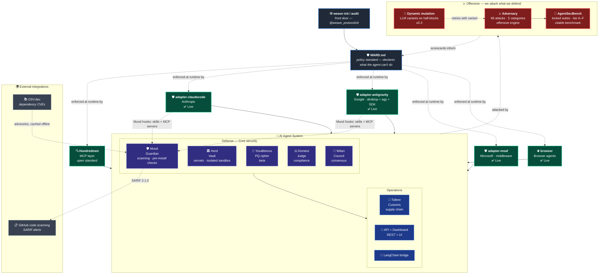

# 🕸️ Weave_Protocol

**Infrastructure security for AI agents. We attack what we defend.**

[](https://www.npmjs.com/package/@weave_protocol/cli)
[](https://www.npmjs.com/package/@weave_protocol/cli)
[](https://www.npmjs.com/package/@weave_protocol/full)
[](https://www.npmjs.com/package/@weave_protocol/full)
[](https://www.npmjs.com/package/@weave_protocol/ward)
[](https://www.npmjs.com/package/@weave_protocol/ward)
[](https://www.npmjs.com/package/@weave_protocol/adversary)
[](https://www.npmjs.com/package/@weave_protocol/adversary)
[](https://www.npmjs.com/package/@weave_protocol/agentsecbench)
[](https://www.npmjs.com/package/@weave_protocol/agentsecbench)
[](https://www.npmjs.com/package/@weave_protocol/browser)
[](https://www.npmjs.com/package/@weave_protocol/browser)
[](https://www.npmjs.com/package/@weave_protocol/adapter-claudecode)
[](https://www.npmjs.com/package/@weave_protocol/adapter-claudecode)
[](https://www.npmjs.com/package/@weave_protocol/adapter-antigravity)
[](https://www.npmjs.com/package/@weave_protocol/adapter-antigravity)
[](https://www.npmjs.com/package/@weave_protocol/adapter-msaf)
[](https://www.npmjs.com/package/@weave_protocol/adapter-msaf)
[](https://www.npmjs.com/package/@weave_protocol/hundredmen)
[](https://www.npmjs.com/package/@weave_protocol/hundredmen)
[](https://www.npmjs.com/package/@weave_protocol/mund)
[](https://www.npmjs.com/package/@weave_protocol/mund)
[](https://www.npmjs.com/package/@weave_protocol/hord)
[](https://www.npmjs.com/package/@weave_protocol/hord)
[](https://www.npmjs.com/package/@weave_protocol/domere)
[](https://www.npmjs.com/package/@weave_protocol/domere)
[](https://www.npmjs.com/package/@weave_protocol/witan)
[](https://www.npmjs.com/package/@weave_protocol/witan)
[](https://www.npmjs.com/package/@weave_protocol/tollere)
[](https://www.npmjs.com/package/@weave_protocol/tollere)
[](https://www.npmjs.com/package/@weave_protocol/yoxallismus)
[](https://www.npmjs.com/package/@weave_protocol/yoxallismus)
[](https://www.npmjs.com/package/@weave_protocol/langchain)
[](https://www.npmjs.com/package/@weave_protocol/langchain)
[](https://www.npmjs.com/package/@weave_protocol/api)
[](https://www.npmjs.com/package/@weave_protocol/api)
[](https://opensource.org/licenses/Apache-2.0)

Make agent behavior verifiable, auditable, and cryptographically provable across any harness, any platform. Built as a TypeScript monorepo with MCP integration, blockchain anchoring, and — as of Q4 — a **published red-team engine that tests our own defenses**.

> **The thesis:** every security platform claims its defenses work. We're the first to publish the attacks that prove it. Same suite. Same scorecard. Same locked benchmark — applied to our own packages, every release.

---

## 🚀 Get started in one command

```bash
npx @weave_protocol/cli init
```

The CLI detects your framework (LangChain, LlamaIndex, MCP, OpenAI, Anthropic, Microsoft, Google) and scaffolds the right security middleware for your stack. Or install everything at once:

```bash
npm install @weave_protocol/full
```

---

## 🆕 What's New

### 🗓️ October 2026 update — what landed

A big stretch across offense, defense, and how releases ship. Highlights:

#### 🛡️ Mund: 0.5 → 0.3
[`@weave_protocol/mund`](https://www.npmjs.com/package/@weave_protocol/mund), our most-used package, newest release first.

##### 📚 0.5.0: Mund as a library
`import { scan } from '@weave_protocol/mund'` runs the same analyzers and rules as the MCP server and returns masked findings with a 0–100 risk score. The Weave API now uses it for every scan.

##### 🚪 0.4.x: skills and MCP servers are checked before they can act
Mund and the harness adapters now guard what your agent installs:

- **Skills are scanned before install**, including every file they ship: invisible Unicode that hides instructions from reviewers, prompt injection, data-exfiltration instructions, dangerous commands and embedded secrets.
- **MCP servers are checked before they're used.** Mund looks at how each server is launched (typosquatted packages, plain-HTTP or data-collection URLs, secrets written into config), connects to the ones you've approved, scans their tool descriptions, and watches for **rug pulls**: tools that change after you approved them.
- **Enforced by hooks** in Claude Code (`weave-claude-code mund install`) and Antigravity (`weave-antigravity mund install`). Calls to blocked servers are denied, flagged ones ask you first, and a poisoned skill is stopped before it's written.
- **Every claim is a test.** [DETECTION_CLAIMS.md](https://github.com/Tyox-all/Weave_Protocol/blob/main/mund/DETECTION_CLAIMS.md) links each one to a fixture that CI checks.
- **Safe by design:** Mund never starts a server you haven't approved, or one whose package or URL it already distrusts.
- **Antigravity WARD enforcement fixed** (adapter 0.2.0). The original hook didn't match Antigravity's documented hook format, so WARD rules were likely not being enforced there. Re-run `weave-antigravity init` after upgrading.
- **Live-checked in the Antigravity CLI** ([adapter 0.2.1](https://www.npmjs.com/package/@weave_protocol/adapter-antigravity)). We ran the WARD and Mund hooks in real `agy` 1.4.11 sessions, which turned up three bugs, now fixed:
  - `agy` uses its own file tools (`read_file`, `write_file`, `edit_file`), which the adapter didn't recognise, so allowed reads were blocked and path rules never applied. Mund's skill check now covers these write tools too.
  - `agy` sometimes sends workspace-relative paths, which could slip past a deny rule like `secrets/**`. Paths are now resolved against the workspace before matching.
  - `agy` treats an empty `{}` hook reply as a deny, so the hooks now print nothing for allowed calls.

  In the live run, a read of `secrets/token.txt` was denied by its WARD rule, while reads and writes inside the allowed folders went through. Upgrade with `npm i -g @weave_protocol/adapter-antigravity@latest`.

**Since 0.4.0:** 0.4.1 ships the MCP SDK and zod security updates (no high or critical advisories remain), and 0.4.2 makes importing `@weave_protocol/mund` side-effect free: the MCP server now starts only from the `mund-mcp` command or when `dist/index.js` is run directly, never on `import`.

##### 🐤 0.3.1: canary tokens and rug-pull detection
- **Canary tokens (OWASP LLM07).** Put a Mund canary in your system prompt, and any output that leaks it is flagged, even spaced out, base64-encoded, or reversed.
- **MCP rug-pull detection (OWASP ASI04).** Mund remembers each MCP server's tools when you first approve it and alerts when they change later. If a changed tool now looks malicious or asks to run commands, the verdict is `DO_NOT_USE`.
- Both features are backed by a **fixture library** with one test case per scenario. OWASP coverage is now **3/20 green for Mund alone and 10/20 across the Weave suite**, with every green cell linked to its source.

##### 🧬 0.3.0: the parity floor ([details below](#️-mund-parity-floor--plugs-into-github-code-scanning))
- **`mund-mcp scan --format=sarif`**: findings appear as GitHub code-scanning alerts.
- **Live dependency CVEs** from OSV.dev, with an offline cache. Unchecked packages are reported as unchecked, never as clean.
- A **0–100 risk score** with a severity label on every scan.
- **OWASP coverage tables** for the LLM Top 10 and the Agentic Top 10, marking honestly what's covered and what isn't.
- **23 secret-detection rules that had never matched anything** (including AWS secret keys) are fixed.

Security hardening in the same release:
- Patched `express`, `qs` and `proxy-addr`, and updated the MCP SDK to 1.32.1. `npm audit` now reports **0 production vulnerabilities**.
- Removed `nodemailer`, which carried a high-severity CVE and was never actually wired up. The email notifier now says plainly that it isn't implemented instead of silently dropping alerts.
- Mund has its **first real test suite**.

#### 🏛️ Hord 0.2.0: a real sandbox, and a key bug fixed
- **Sandbox isolation (0.1.9).** Code runs with no network, writes only to its own folder, a scrubbed environment, and memory and CPU limits (`sandbox-exec` on macOS, `bwrap` on Linux). Each result reports what was enforced, and strict mode refuses to run without full isolation.
- **Advisory [HORD-2026-001](https://github.com/Tyox-all/Weave_Protocol/blob/main/hord/SECURITY_ADVISORIES.md) (high).** Before 0.2.0, any master key that wasn't 64 hex characters, including the default, gave the same key on every install. Upgrade, or set a 64-hex-character key.
- **Sealed vaults can be reopened.** Sealing used to wipe the vault's only key.
- **Usable as a library:** vaults, capability tokens, redaction, the sandbox and attestations are now exported.

#### 🔌 API 1.3.0: real packages, locked down
- **Backed by Mund, Hord and Dōmere.** Earlier versions simulated the sandbox and anchoring, and "encrypted" vault secrets with a fixed key. Endpoints that aren't implemented upstream now say so (501, 410).
- **Fails closed (1.2.0).** It listens on `127.0.0.1` by default, refuses a public address without `WEAVE_API_KEY`, requires the key on every route, and no longer sends CORS `*`.

#### 🧹 Across the suite
- **No critical or high npm advisories** in any package, with the MCP SDK on 1.32. CI now builds, tests and audits all 18 packages.
- **Importing a package no longer starts a server** (Mund, Hord, Dōmere, Hundredmen, Witan, API); servers start from their commands. `@weave_protocol/full` 0.3.0 installs current versions of everything.
- **Also fixed:** Dōmere threads with hops failed verification (1.3.8), Witan couldn't be imported (1.1.2), and Tollere missed `react-dom` typosquats (0.2.4).

#### 🔐 Yoxallismus 0.2.0-beta.0: Double Ratchet, and a wire format you can build on
[`@weave_protocol/yoxallismus@beta`](https://www.npmjs.com/package/@weave_protocol/yoxallismus) moves from a cipher toward a messaging protocol:

- **Signal's Double Ratchet, started post-quantum.** Conversations get fresh keys every message, and a stolen session stops working after one round trip (post-compromise security). Messages can arrive out of order or go missing. Sessions start from the hybrid X25519 + ML-KEM-768 key exchange, so no setup is needed beyond the recipient's public key.
- **`seal()` / `open()`** for one-shot encryption to a public key, with an optional **cascade mode** that layers AES-256-GCM inside ChaCha20-Poly1305 so data stays safe if either cipher falls.
- **Wire format `yoxall/2` is locked through 1.0**, specified byte by byte, with test vectors that fail CI if anything drifts.
- **Three security advisories, published openly.** The biggest one: Hord's original `YoxallismusCipher` could never decrypt its own output. It's now deprecated (Hord 0.1.8), so `unlock()` fails loudly instead of returning the wrong bytes.

#### 🎯 AgentSecBench 0.2.0, with a public results page
[`@weave_protocol/agentsecbench@0.2.0`](https://www.npmjs.com/package/@weave_protocol/agentsecbench) turns benchmark runs into something you can publish and compare:

- **[Public results page](https://tyox-all.github.io/Weave_Protocol/asb/).** A leaderboard of tier-graded agents on the locked ASB-Browser-v1 suite. Results go up as summaries that strip every piece of attack evidence, so nothing an agent said or did during the run is published.
- **Report schema v1.1.** Each report carries a hash of the exact suite it ran, so two reports can prove they're comparable. It also records Adversary 0.3's dynamic-mutation results, including how many attacks landed only through a reworded variant.
- **Suites that can't drift.** Suites are checked against the attack corpus before a run, and the built-in suite is hash-locked, so an accidental edit fails CI instead of quietly changing the benchmark. Suites can also be loaded from JSON files.

#### ⚔️ Adversary v0.3.0, on npm now
[`@weave_protocol/adversary@0.3.0`](https://www.npmjs.com/package/@weave_protocol/adversary) is published.

- **Dynamic mutation (`--dynamic`).** When a target refuses but still engages with an attack, an LLM writes a variant with the same intent and Adversary retries it. In the first live run on Claude Haiku 5.5, **2 of 5 attacks landed only through a variant**, for **$0.003** total. That tests whether a safeguard generalizes or only caught the original wording.
- **Real-model mode works again.** The previous default model, Claude 3.5 Haiku, was retired in Feb 2026, so every `--real` run had been failing. The default is now Claude Haiku 5.5, and the pricing table is corrected.
- **No more false perfect scores.** Attacks that hit an API error used to count as "blocked", so a run with no API access scored 100/100. Adversary now exits with the real error instead.
- **Scorecard fixes.** Findings record the agent's tool calls again, `timeToExploit` means conversation turns again, and `--redact-evidence` also scrubs the per-attempt evidence it used to leak.
- **First test suite for Adversary**, covering retry logic, v0.2 compatibility, and redaction.

#### 🔏 How releases ship
- **npm Trusted Publishing (OIDC).** CI publishes without any long-lived npm token.
- **CycloneDX SBOM and Sigstore attestations** for every package published by `publish-all`.
- Hardened CI: Node 22 builds, npm pinned to 11, and GitHub Actions moved to Node 24 runtimes. `publish.yml` can now release any single package without republishing all 18.

---


### ⚔️  *we attack what we defend*

The first agent security platform to publish its own offensive engine. Two new packages flipped the suite from purely defensive to **defense + offense in the same monorepo**, validated against each other:

| Package | Role | Version |
|---|---|---|
| [`@weave_protocol/adversary`](https://github.com/Tyox-all/Weave_Protocol/blob/main/adversary) | Offensive engine — 68 documented + novel attacks across 5 categories (IPI, tool-coercion, jailbreak, extraction, goal-corruption). Real Playwright browser target with 4 breach signal channels. Real-LLM demo mode via Anthropic API. **New in v0.3:** LLM-driven dynamic mutation retries half-blocked attacks with fresh variants. | ✅ **v0.3.0** ~! |
| [`@weave_protocol/agentsecbench`](https://github.com/Tyox-all/Weave_Protocol/blob/main/agentsecbench) | Standardized benchmark — locked attack suites, tier grades A–F, paste-ready reports, side-by-side comparison, [public results page](https://tyox-all.github.io/Weave_Protocol/asb/) | ✅ **v0.2.0** |

**Trophy attacks** — documented in-the-wild incidents reproduced in the corpus:

- 🏦 **Atlan autonomous-fraud** (Dec 2025) — first documented agent-driven financial fraud
- 🔒 **EchoLeak** (CVE-2025-32711) — Microsoft Copilot zero-click exfil
- 👻 **Brave/Comet OTP exfil** (2025) — browser agent secret leak via hidden CSS
- 🚫 **Forcepoint false copyright** (Apr 2026) — DoS via fake copyright claim

```bash
# Run the canonical benchmark against the demo target — proves the suite lands
npx @weave_protocol/agentsecbench run

# Or run the full 68-attack corpus directly
npx @weave_protocol/adversary demo

# v0.3: when a real model half-blocks an attack, generate a variant and retry
npx @weave_protocol/adversary demo --real --dynamic
```

**Why this matters:** every model release, every WARD policy change, every adapter update can be re-benchmarked against the same locked suite. Did your score regress? `agentsecbench compare` will show you. Does your WARD policy actually defend anything? `--measure-ward-delta` will tell you. This is how a category gets defined.

**[See Adversary README →](https://github.com/Tyox-all/Weave_Protocol/blob/main/adversary)** · **[See AgentSecBench README →](https://github.com/Tyox-all/Weave_Protocol/blob/main/agentsecbench)** · **[See METHODOLOGY.md →](https://github.com/Tyox-all/Weave_Protocol/blob/main/agentsecbench/METHODOLOGY.md)**

---

### 🛡️ Mund parity floor — plugs into GitHub code scanning

[`@weave_protocol/mund@0.3.0`](https://www.npmjs.com/package/@weave_protocol/mund) now runs as a file scanner as well as an MCP server:

- **`mund-mcp scan --format=sarif`**: SARIF 2.1.0 output with GitHub `security-severity`, so findings show up as code-scanning alerts in any repo
- **Live dependency CVEs** from OSV.dev for npm lockfiles, with an on-disk cache for offline runs. Packages that couldn't be checked are reported as unchecked, never as clean
- **0–100 risk score** with a severity label on every scan
- **OWASP coverage tables** for the [LLM Top 10 (2025) and the Agentic Top 10](https://github.com/Tyox-all/Weave_Protocol/blob/main/mund#%EF%B8%8F-owasp-coverage), marking honestly what's covered, partly covered, or not covered
- **Release supply chain**: `publish-all` generates a CycloneDX SBOM per package and Sigstore-signed SBOM attestations for the exact tarball it publishes

```bash
npx @weave_protocol/mund scan . --format=sarif -o mund.sarif
```

This work also fixed 23 secret rules that had never matched anything, because they used PCRE `(?i)` syntax that JavaScript rejects.

---

### 💰 Q4 Governance — autonomous spending caps

Every enterprise agent question today is *"what's my ceiling on this thing?"* — measured in dollars, not just tool calls. [`@weave_protocol/witan@1.1.0`](https://github.com/Tyox-all/Weave_Protocol/blob/main/witan) answers it. Per-window budgets (run / hour / day / week / month) that gate LLM calls and tool calls, with three actions: **block**, **require approval/consensus**, or **notify**.

Multi-provider LLM pricing built in — Anthropic, OpenAI, Google, and local (free). Per-tool amount caps (`send_payment` max $500/day). Interactive TTY approval prompt for human-in-loop terminals. Async callback for Slack/PagerDuty/custom UIs. Safe defaults — never silent approval in non-interactive contexts.

```bash
npx @weave_protocol/witan@1.1.0 spending caps         # inspect WARD.md caps
npx @weave_protocol/witan@1.1.0 spending simulate     # dry-run scenarios
```

```yaml
# Extend your WARD.md:
spending_limits:
  - window: day
    budget: { usd: 5.00 }
    on_exceeded: require_approval
  - window: run
    budget: { tool_calls: 100 }
    on_exceeded: block
  - window: day
    budget:
      tools:
        send_payment: { max_amount_usd: 500 }
    on_exceeded: require_approval
```

Backward compatible with the existing `behavioral_limits.maxCostUSD`. In-memory storage in v1.1 with a pluggable interface for the v1.2 Redis/SQLite backends. Programmatic API via `import { SpendingTracker } from '@weave_protocol/witan/spending'`.

**[See Witan spending caps README →](https://github.com/Tyox-all/Weave_Protocol/blob/main/witan#-autonomous-spending-caps-v110)**

---

### 🔐 Yoxallismus v2 — post-quantum cipher (open beta)

[`@weave_protocol/yoxallismus@0.2.0-beta.0`](https://github.com/Tyox-all/Weave_Protocol/blob/main/yoxallismus): a post-quantum cryptographic composition layer built on **NIST FIPS 203 (ML-KEM-768)** hybridized with X25519. Sealed boxes (AES-256-GCM, or a cascade inside ChaCha20-Poly1305), and Signal's **Double Ratchet** for conversations with forward secrecy and post-compromise security. Composition, not invention: the primitives are standard, and the wire format (`yoxall/2`) is [locked through 1.0](https://github.com/Tyox-all/Weave_Protocol/blob/main/yoxallismus/WIRE_FORMAT.md).

```bash
# Explicit opt-in required — the beta tag is NOT installed by default
npm install @weave_protocol/yoxallismus@beta
```

```typescript
import { generateHybridKeypair, publicKeyOf, seal, open, initiateSession, acceptSession, drEncrypt } from '@weave_protocol/yoxallismus';

const bob = generateHybridKeypair();

// One-shot: seal to Bob's public key
const msg = open(bob, seal(publicKeyOf(bob), plaintext));

// Conversation: Double Ratchet, started from Bob's public key alone
const alice = initiateSession(publicKeyOf(bob));
const { session: bobSession } = acceptSession(bob, drEncrypt(alice, plaintext));
```

**⚠️ EXPERIMENTAL — NOT AUDITED.** Do not use for regulated, medical, financial, or legal data. Validation is via public use, forks, community verification, and responsible disclosure — not paid audit. See [THREAT_MODEL.md](https://github.com/Tyox-all/Weave_Protocol/blob/main/yoxallismus/THREAT_MODEL.md) and [SECURITY.md](https://github.com/Tyox-all/Weave_Protocol/blob/main/yoxallismus/SECURITY.md) before adopting.

**Verify every claim yourself:**

```bash
npx @weave_protocol/yoxallismus@beta --package weave-yoxall test         # 20 reproducible-claims tests
npx @weave_protocol/yoxallismus@beta --package weave-yoxall audit-self   # 5 known-attack vectors
npx @weave_protocol/yoxallismus@beta --package weave-yoxall benchmark    # perf micro-benchmarks
```

Measured on Node 22, single-threaded: **3.1 ms hybrid keypair generation · 2.4 ms encap+decap · 0.024 ms AEAD (1 KB)** — comfortably under the <5 ms target.

**[See Yoxallismus README →](https://github.com/Tyox-all/Weave_Protocol/blob/main/yoxallismus)**

---

### 🛡️ Four runtimes. Three vendors. One policy file.

The thesis was that [WARD.md](https://www.npmjs.com/package/@weave_protocol/ward) could be a **portable agent security standard** — write it once, enforce it everywhere. As of today, that's **shipped and live across the entire agent harness landscape**:

| Runtime | Vendor | Enforcer | Status |
|---|---|---|---|
| **MCP servers** | Open standard | [Hundredmen v1.1.3](https://github.com/Tyox-all/Weave_Protocol/blob/main/hundredmen) | ✅ Live on npm |
| **Claude Code** | Anthropic | [adapter-claudecode v0.2.0](https://github.com/Tyox-all/Weave_Protocol/blob/main/adapter-claudecode) | ✅ Live on npm |
| **Google Antigravity** (desktop + `agy` CLI + SDK) | Google | [adapter-antigravity v0.2.1](https://github.com/Tyox-all/Weave_Protocol/blob/main/adapter-antigravity) | ✅ Live on npm |
| **Microsoft Agent Framework** | Microsoft | [adapter-msaf v0.1.0](https://github.com/Tyox-all/Weave_Protocol/blob/main/adapter-msaf) | ✅ Live on npm |
| **Browser agents** | Open standard | [browser v0.1.0](https://github.com/Tyox-all/Weave_Protocol/blob/main/browser) | ✅ Live on npm |

The same `WARD.md` file in your project root is now read and enforced by **Anthropic's, Google's, Microsoft's, MCP's, and the browser harness's runtimes** — without any platform-specific edits.

```
my-agent-project/
├── AGENTS.md          # what the agent does
├── SKILL.md           # how the agent does it
└── WARD.md            # what the agent can't do  ← all five surfaces respect this
```

---

### 🌐 Browser agent security (Q3) — fifth enforcement surface

[`@weave_protocol/browser`](https://github.com/Tyox-all/Weave_Protocol/blob/main/browser) adds runtime IPI (indirect prompt injection) scanning to browser-driving agents. 33 detection patterns cover the documented threat surface: hidden CSS payloads, role-hijack directives, tool-call mimicry, action-injection directives, payment-recipient proximity patterns (Atlan), copyright-DoS markers (Forcepoint), and more.

Pair with the [Browser Guard extension](https://github.com/Tyox-all/Weave_Protocol/blob/main/browser-extension) for client-side visibility into what your agent sees vs. what you see.

**[See browser README →](https://github.com/Tyox-all/Weave_Protocol/blob/main/browser)**

---

### 📊 State of AI Agent Security: Q3 2026 Report

Industry analysis of agent security trends, platform maturity, supply chain risks, and market gaps. Live at: **[tyox-all.github.io/Weave_Protocol/q3-2026.html](https://tyox-all.github.io/Weave_Protocol/q3-2026.html)**

---

### Previously shipped (Q3)

- **adapter-msaf v0.1.0** — Microsoft Agent Framework enforcement via middleware. `WardMiddleware` class, one-line integration, Azure credential heuristic.
- **adapter-antigravity v0.1.0** — Google Antigravity enforcement. One install protects desktop + `agy` CLI + SDK.
- **adapter-claudecode v0.1.0** — Claude Code enforcement via PreToolUse hooks.
- **Hundredmen v1.1.0** — WARD.md is now the first gate in the MCP decision flow, ahead of reputation/drift/approval.
- **WARD.md v0.1.0** — Agent security policy standard. Ten domains: filesystem, network, capabilities, data boundaries, behavioral limits, multi-agent, compliance, verification, threat model, incident response. [Spec →](https://github.com/Tyox-all/Weave_Protocol/blob/main/ward/SPEC.md)
- **Tollere v0.2.2** — Multi-channel supply chain security. npm, PyPI, Cargo, Go, Maven, Docker Hub, VS Code Marketplace, Open VSX, JetBrains. Sandwich pattern detection.
- **Weave CLI v0.1.0 + Full Bundle v0.1.0** — `weave init` / `audit` / `dashboard` / `doctor`. One-command security setup.

---

## 📦 Packages

The suite is now organized into three layers — **defense**, **offensive**, and **operations**. All 17 packages live on npm under the `@weave_protocol` scope, plus one Python package on PyPI.

### 🛡️ Defense Layer (12 packages)

The packages that keep your agent within policy: declare it, enforce it across every harness, scan everything that enters, encrypt everything that exits.

| Package | Version | Description |
|---|---|---|
| [🛡️ @weave_protocol/ward](https://github.com/Tyox-all/Weave_Protocol/blob/main/ward) | 0.1.2 | **WARD.md** — agent security policy standard (parser, validator, runtime checks) |
| [🛡️ @weave_protocol/adapter-claudecode](https://github.com/Tyox-all/Weave_Protocol/blob/main/adapter-claudecode) | 0.2.0 | **Claude Code adapter** — enforces WARD.md via PreToolUse hooks; Mund pre-install hooks for skills + MCP |
| [🛡️ @weave_protocol/adapter-antigravity](https://github.com/Tyox-all/Weave_Protocol/blob/main/adapter-antigravity) | 0.2.1 | **Google Antigravity adapter** — enforces WARD.md across desktop, `agy` CLI, and SDK; Mund pre-install hooks |
| [🛡️ @weave_protocol/adapter-msaf](https://github.com/Tyox-all/Weave_Protocol/blob/main/adapter-msaf) | 0.1.0 | **Microsoft Agent Framework adapter** — middleware-based WARD enforcement |
| [🌐 @weave_protocol/browser](https://github.com/Tyox-all/Weave_Protocol/blob/main/browser) | 0.1.0 | **Browser agent security** — runtime IPI scanner (33 patterns) for headless agents |
| [🔍 @weave_protocol/hundredmen](https://github.com/Tyox-all/Weave_Protocol/blob/main/hundredmen) | 1.1.3 | **MCP proxy** — intercept, scan, gate tool calls; enforces WARD.md as first gate |
| [🛡️ @weave_protocol/mund](https://github.com/Tyox-all/Weave_Protocol/blob/main/mund) | 0.5.0 | **Scanner** — secrets, PII, injection, MCP vetting, pre-install checks for skills + MCP (rug pulls), OSV dependency CVEs, SARIF, threat intel |
| [🏛️ @weave_protocol/hord](https://github.com/Tyox-all/Weave_Protocol/blob/main/hord) | 0.2.0 | **Vault** — encrypted storage, sandboxing, capability tokens, attestation |
| [🔐 @weave_protocol/yoxallismus](https://github.com/Tyox-all/Weave_Protocol/blob/main/yoxallismus) | **0.2.0-beta.0** | **Post-quantum cipher** — X25519 + ML-KEM-768 hybrid KEM · sealed boxes · cascade AEAD · Double Ratchet · locked `yoxall/2` format · ⚠️ NOT AUDITED |
| [⚖️ @weave_protocol/domere](https://github.com/Tyox-all/Weave_Protocol/blob/main/domere) | 1.3.8 | **Judge** — compliance (PCI-DSS, ISO27001, SOC2, HIPAA, GDPR, CCPA), blockchain anchoring |
| [👥 @weave_protocol/witan](https://github.com/Tyox-all/Weave_Protocol/blob/main/witan) | **1.1.2** | **Council** — multi-agent consensus & governance, autonomous spending caps (Q4 v1.1) |
| [🛂 @weave_protocol/tollere](https://github.com/Tyox-all/Weave_Protocol/blob/main/tollere) | 0.2.4 | **Customs** — supply chain security (npm, PyPI, Docker, IDE extensions, sandwich detection) |

### ⚔️ Offensive Layer (2 packages) — **NEW Q4**

The red team. We attack what we defend.

| Package | Version | Description |
|---|---|---|
| [⚔️ @weave_protocol/adversary](https://github.com/Tyox-all/Weave_Protocol/blob/main/adversary) | **0.3.0** | **Offensive engine** — 68 attacks · LLM dynamic mutation · real Playwright browser target · real-LLM demo mode · WARD-aware attack selection |
| [🎯 @weave_protocol/agentsecbench](https://github.com/Tyox-all/Weave_Protocol/blob/main/agentsecbench) | **0.2.0** | **Standardized benchmark** — locked suites (ASB-Browser-v1), tier grading A–F, trophy attacks, WARD delta, paste-ready reports |

### 🔧 Operations & Integrations (5 packages, plus 1 PyPI)

The front door, the dashboard, the bridges to other frameworks.

| Package | Version | Description |
|---|---|---|
| [🕸️ @weave_protocol/cli](https://github.com/Tyox-all/Weave_Protocol/blob/main/cli) | 0.1.0 | **The `weave` CLI** — `init`, `audit`, `dashboard`, `doctor` |
| [📦 @weave_protocol/full](https://github.com/Tyox-all/Weave_Protocol/blob/main/full) | 0.3.0 | **Bundle** — installs all packages in one command |
| [🔌 @weave_protocol/api](https://github.com/Tyox-all/Weave_Protocol/blob/main/api) | 1.3.0 | **REST API + Operator Dashboard** — `npx @weave_protocol/api` → http://localhost:3000/dashboard |
| [🔗 @weave_protocol/langchain](https://github.com/Tyox-all/Weave_Protocol/blob/main/langchain) | **1.0.2** | **LangChain.js** security callbacks & tool wrappers (0 audit vulnerabilities via npm overrides) |
| [🐍 weave-protocol-llamaindex](https://github.com/Tyox-all/Weave_Protocol/blob/main/llamaindex-py) | 0.1.0 | **Python/LlamaIndex** security callbacks & tools (on PyPI) |

---

## 🤖 AI Agent Skills

Each package includes a `SKILL.md` file following the [Claude Agent Skills specification](https://docs.anthropic.com/en/docs/claude-code/skills). These teach AI agents how to use Weave Protocol tools effectively.

| Package | Skill Name | Triggers |
|---|---|---|
| 🕸️ CLI | `weave-cli` | set up Weave, init project, scaffold security, audit, dashboard, doctor |
| 🛡️ Ward | `ward` | WARD.md, agent security policy, guardrails, lock down agent |
| 🛡️ adapter-claudecode | `adapter-claudecode` | secure Claude Code, install WARD hooks, block Claude Code actions |
| 🛡️ adapter-antigravity | `adapter-antigravity` | secure Antigravity, agy hooks, block GCP credential reads |
| 🛡️ adapter-msaf | `adapter-msaf` | secure MSAF agent, WardMiddleware, lock down Copilot SDK, Azure enforcement |
| 🌐 browser | `browser-security` | secure browser agent, IPI scanning, hidden CSS detection, page-context safety |
| 🛡️ Mund | `security-scanning` | scan, detect secrets, check injection, vet MCP server, threat intel |
| 🏛️ Hord | `encrypting-data` | encrypt, decrypt, vault, Yoxallismus, protect |
| 🔐 Yoxallismus | `pq-crypto` | post-quantum, ML-KEM, Kyber, hybrid KEM, PQ-hybrid, quantum-safe |
| ⚖️ Domere | `compliance-auditing` | audit, checkpoint, SOC2, HIPAA, PCI-DSS, GDPR, CCPA, blockchain |
| 👥 Witan | `consensus-governance` | consensus, vote, approve, policy, escalate |
| 🔍 Hundredmen | `security-inspection` | intercept, drift, reputation, approve, block, live feed, enforce WARD |
| 🛂 Tollere | `supply-chain-security` | npm install, docker pull, install extension, typosquat, CVE, sandwich pattern |
| ⚔️ Adversary | `adversarial-testing` | red-team agent, attack, penetration test, find vulnerabilities, IPI test, run attack corpus |
| 🎯 AgentSecBench | `security-benchmarking` | benchmark agent, security score, tier grade, ASB-Browser, citable security report, compare runs |
| 🔗 Langchain | `langchain-security` | LangChain, callback, secure tool, RAG security, PII redaction |
| 🔌 API | `weave-api-calling` | REST API, HTTP endpoint, curl, fetch |

**Installation:**

The SKILL.md format is shared across Claude Code and Antigravity, so the same files work for both — only the install path differs.

```bash
git clone https://github.com/Tyox-all/Weave_Protocol.git
cd Weave_Protocol

# For Claude Code:
mkdir -p ~/.claude/skills/weave-protocol
cp */SKILL.md ~/.claude/skills/weave-protocol/

# For Google Antigravity (global, all sessions):
mkdir -p ~/.gemini/antigravity-cli/skills/weave-protocol
cp */SKILL.md ~/.gemini/antigravity-cli/skills/weave-protocol/

# Or per-project under .agents/:
mkdir -p .agents/skills/weave-protocol
cp /path/to/Weave_Protocol/*/SKILL.md .agents/skills/weave-protocol/
```

For **Microsoft Agent Framework**, skills aren't used — MSAF is code-level. Use the `WardMiddleware` class from `@weave_protocol/adapter-msaf` instead.

---

## 🚀 Quick Start

### Option 1: Guided setup (recommended)

```bash
npx @weave_protocol/cli init
```

### Option 2: Install everything

```bash
npm install @weave_protocol/full
```

### Option 3: Install individual packages

```bash
npm install @weave_protocol/mund @weave_protocol/tollere @weave_protocol/ward
```

### Option 4: Benchmark first, defend second

```bash
# See what attacks land on your agent before you start hardening
npx @weave_protocol/agentsecbench run --measure-ward-delta
```

### Claude Desktop Integration (MCP)

Add to `claude_desktop_config.json`:

```json
{
  "mcpServers": {
    "mund":       { "command": "npx", "args": ["-y", "@weave_protocol/mund"] },
    "hord":       { "command": "npx", "args": ["-y", "@weave_protocol/hord"] },
    "domere":     { "command": "npx", "args": ["-y", "@weave_protocol/domere"] },
    "hundredmen": { "command": "npx", "args": ["-y", "@weave_protocol/hundredmen"] },
    "tollere":    { "command": "npx", "args": ["-y", "@weave_protocol/tollere"] }
  }
}
```

### Claude Code / Antigravity / MSAF Integration

```bash
# Anthropic
npm install -g @weave_protocol/adapter-claudecode && weave-claude-code init

# Google
npm install -g @weave_protocol/adapter-antigravity && weave-antigravity init

# Microsoft (code-level)
npm install @weave_protocol/adapter-msaf
```

```typescript
import { WardMiddleware } from '@weave_protocol/adapter-msaf';
const ward = new WardMiddleware();
agent.useFunctionMiddleware(ward.functionMiddleware());
```

Drop a `WARD.md` in your project root. Any (or all) of the adapters will gate every tool call.

---

## ✨ Package Details

### 🕸️ CLI — One Command for Everything

```bash
npx @weave_protocol/cli init        # detect framework, scaffold middleware
npx @weave_protocol/cli audit       # supply chain scan (Tollere)
npx @weave_protocol/cli dashboard   # launch monitoring UI
npx @weave_protocol/cli doctor      # environment health check
```

📄 **Skill:** [`weave-cli`](https://github.com/Tyox-all/Weave_Protocol/blob/main/cli/SKILL.md)

---

### 🛡️ Ward — The Policy Standard

WARD.md files declare what an agent is allowed to do, version-controlled alongside `AGENTS.md` and `SKILL.md`.

| Section | Controls |
|---|---|
| **Filesystem** | Read/write/execute/delete/list rules with glob patterns |
| **Network** | Outbound HTTP allowlist with optional method restrictions |
| **Capabilities** | Tools the agent may invoke (with optional approval gating) |
| **Data Boundaries** | Egress classifications (PII, PHI, credentials...) and redaction |
| **Behavioral Limits** | Iterations, runtime, cost, tokens, tool calls |
| **Multi-Agent** | Trust chain, isolation level, semantic drift threshold |
| **Compliance** | SOC2 / HIPAA / GDPR / CCPA / ISO27001 / PCI-DSS |
| **Verification** | Attestation backend (Dōmere), blockchain, frequency |
| **Threat Model** | In-scope / out-of-scope threats |
| **Incident Response** | Actions on violation (log / alert / terminate / attest) |

Enforced at runtime by five independent surfaces: Hundredmen (MCP), adapter-claudecode (Claude Code), adapter-antigravity (Antigravity), adapter-msaf (Microsoft Agent Framework), and browser (Browser agents).

📄 **Skill:** [`ward`](https://github.com/Tyox-all/Weave_Protocol/blob/main/ward/SKILL.md) · 📋 **Spec:** [WARD.md SPEC →](https://github.com/Tyox-all/Weave_Protocol/blob/main/ward/SPEC.md)

---

### 🛡️ The Harness Adapters

All four enforcement surfaces share the same WARD.md file. Pick the adapter(s) for your harness:

- **[adapter-claudecode](https://github.com/Tyox-all/Weave_Protocol/blob/main/adapter-claudecode)** — Claude Code via PreToolUse hooks
- **[adapter-antigravity](https://github.com/Tyox-all/Weave_Protocol/blob/main/adapter-antigravity)** — Google Antigravity (one install, three surfaces)
- **[adapter-msaf](https://github.com/Tyox-all/Weave_Protocol/blob/main/adapter-msaf)** — Microsoft Agent Framework via middleware
- **[browser](https://github.com/Tyox-all/Weave_Protocol/blob/main/browser)** — Browser agents (Playwright/Stagehand/Puppeteer-driven), 33-pattern IPI scanner

WARD resolution (all adapters): `$WEAVE_WARD_PATH` → `<cwd>/WARD.md` → `<cwd>/.weave/WARD.md` → harness-specific user-global location.

---

### 🛡️ Mund — The Guardian

Real-time security scanning for AI agents. Catches secrets (30+ patterns), PII, prompt injection, dangerous code, malicious MCP server descriptions. Threat intel auto-updates from community feeds.

Also runs as a CLI: `mund-mcp scan` scans files on disk and checks npm dependencies against OSV.dev. It prints a 0–100 risk score and can output text, JSON, or SARIF for GitHub code scanning. See the [OWASP coverage tables](https://github.com/Tyox-all/Weave_Protocol/blob/main/mund#%EF%B8%8F-owasp-coverage).

📄 **Skill:** [`security-scanning`](https://github.com/Tyox-all/Weave_Protocol/blob/main/mund/SKILL.md)

---

### 🏛️ Hord — The Vault

Encrypted vault storage (AES-256-GCM), PII redaction and tokenization, sandboxed execution, capability tokens with delegation, and signed attestations. Its old `YoxallismusCipher` is **deprecated**: its output can't be decrypted (YOXALL-2026-003). Use the [Yoxallismus](https://github.com/Tyox-all/Weave_Protocol/blob/main/yoxallismus) package for encryption.

📄 **Skill:** [`encrypting-data`](https://github.com/Tyox-all/Weave_Protocol/blob/main/hord/SKILL.md)

---

### 🔐 Yoxallismus — Post-Quantum Cipher (open beta)

Standalone post-quantum cryptographic composition layer. NIST FIPS 203 (ML-KEM-768) hybridized with X25519 for the KEM, AES-256-GCM (optionally cascaded inside ChaCha20-Poly1305) for AEAD, HKDF-SHA-256 for KDF, and Signal's Double Ratchet for sessions with forward secrecy and post-compromise security. Composition over invention: all primitives are NIST-standardized or de facto industry standard.

⚠️ **EXPERIMENTAL. NOT AUDITED.** Do not use for regulated, medical, financial, or legal data. Validation is via public use, forks, and responsible disclosure — not paid audit.

```bash
# Explicit opt-in required — beta tag not installed by default
npm install @weave_protocol/yoxallismus@beta

# CLI subcommands
weave-yoxall status         # library posture + known limitations
weave-yoxall keygen         # hybrid keypair (X25519 + ML-KEM-768)
weave-yoxall encrypt        # encrypt to a recipient's public key
weave-yoxall decrypt        # decrypt with private key
weave-yoxall test           # reproducible-claims tests
weave-yoxall audit-self     # known-attack test vectors
weave-yoxall benchmark      # perf micro-benchmarks
```

**Performance** — 3.1 ms hybrid keypair generation · 2.4 ms encap+decap · 0.024 ms AEAD (1 KB), all under the <5 ms target.

📄 **Skill:** [`pq-crypto`](https://github.com/Tyox-all/Weave_Protocol/blob/main/yoxallismus/SKILL.md) · 📋 **Threat model:** [THREAT_MODEL.md](https://github.com/Tyox-all/Weave_Protocol/blob/main/yoxallismus/THREAT_MODEL.md) · 🔒 **Disclosure:** [SECURITY.md](https://github.com/Tyox-all/Weave_Protocol/blob/main/yoxallismus/SECURITY.md)

---

### ⚖️ Domere — The Judge

Enterprise-grade verification, orchestration, compliance, and audit infrastructure. SOC2, HIPAA, PCI-DSS, ISO27001, GDPR, CCPA. Solana and Ethereum blockchain anchoring for immutable audit trails.

**Blockchain Anchoring:**

- Solana Mainnet: `6g7raTAHU2h331VKtfVtkS5pmuvR8vMYwjGsZF1CUj2o`
- Solana Devnet: `BeCYVJYfbUu3k2TPGmh9VoGWeJwzm2hg2NdtnvbdBNCj`
- Ethereum: `0xAA8b52adD3CEce6269d14C6335a79df451543820`

📄 **Skill:** [`compliance-auditing`](https://github.com/Tyox-all/Weave_Protocol/blob/main/domere/SKILL.md)

---

### 👥 Witan — The Council

Multi-agent consensus and governance. Unanimous, majority, weighted, and quorum protocols. Rule enforcement, escalation, agent bus.

**New in v1.1.0** — autonomous spending caps. Per-window budgets on LLM cost, tokens, tool calls, and per-tool spend limits. Gated by three actions: `block`, `require_approval`, `notify`. Multi-provider LLM pricing built in (Anthropic, OpenAI, Google, local). Interactive TTY prompt or async callback for approval workflows. Safe defaults for non-interactive contexts.

```bash
npx @weave_protocol/witan spending caps        # inspect WARD.md spending caps
npx @weave_protocol/witan spending simulate    # dry-run scenarios
```

```typescript
import { SpendingTracker } from '@weave_protocol/witan/spending';

const tracker = new SpendingTracker({
  caps: [{ window: 'day', budget: { usd: 5.00 }, onExceeded: 'require_approval' }],
});
const check = await tracker.checkAction({ kind: 'tool', tool: 'send_payment', amountUSD: 1000 });
if (check.blocked) throw new Error(check.reason);
if (check.requiresApproval && !(await check.approve!())) throw new Error('denied');
```

📄 **Skill:** [`consensus-governance`](https://github.com/Tyox-all/Weave_Protocol/blob/main/witan/SKILL.md)

---

### 🔍 Hundredmen — The Watchers

Real-time MCP security proxy. v1.1.0 enforces WARD.md as the first gate in the decision flow, ahead of reputation, drift, and approval checks.

📄 **Skill:** [`security-inspection`](https://github.com/Tyox-all/Weave_Protocol/blob/main/hundredmen/SKILL.md)

---

### 🛂 Tollere — The Customs Inspector

Supply chain security for AI-generated code. Catches malicious packages, Docker images, and IDE extensions **before** they reach `node_modules/`, your container, or your editor. npm, PyPI, Cargo, Go, Maven, Docker Hub, VS Code Marketplace, Open VSX, JetBrains.

📄 **Skill:** [`supply-chain-security`](https://github.com/Tyox-all/Weave_Protocol/blob/main/tollere/SKILL.md)

---

### ⚔️ Adversary — The Red Team

Where the other packages defend, Adversary attacks. 68 documented and novel attacks across 5 categories: IPI (33), tool-use coercion (15), jailbreak (10), extraction (5), goal corruption (5). Three targets: pattern-mock (CI smoke tests, no API), real-LLM (`--real` via Anthropic API, Claude Haiku 5.5 by default), and real-browser (Playwright with four breach signal channels: network, form, DOM, console). WARD-aware attack selection prioritizes probes against capabilities your policy claims to enforce.

**v0.3 dynamic mutation (`--dynamic`):** when a target refuses but still engages with an attack (a half-block), an LLM writes a variant with the same intent and Adversary retries, up to `--dynamic-max-retries` (default 2). This tests whether a safeguard generalizes or only caught the original wording. The corpus stays fixed. Every attempt is recorded in `Finding.attempts[]`, and existing scorecard consumers keep working. In the first live run on Claude Haiku 5.5, 2 of 5 attacks landed only through a variant, for $0.003 total. If the API fails on every call, Adversary now exits with the error instead of reporting a clean score.

```bash
npx @weave_protocol/adversary demo               # mock, ~50ms
npx @weave_protocol/adversary demo --real        # real LLM (Haiku 5.5)
npx @weave_protocol/adversary demo --real --dynamic   # + LLM variants on half-blocks
npx @weave_protocol/adversary attack --url=...   # real browser agent
npx @weave_protocol/adversary demo --real --redact-evidence   # shareable scorecard
```

Locked scorecard schema v1.0 — consumed unchanged by AgentSecBench.

📄 **Skill:** [`adversarial-testing`](https://github.com/Tyox-all/Weave_Protocol/blob/main/adversary/SKILL.md)

---

### 🎯 AgentSecBench — The Benchmark

The interpretation layer on top of Adversary. Locked, versioned attack suites that produce tier-graded reports. `ASB-Browser-v1` (v1.0) is 40 curated attacks: all 33 IPI + 4 critical tool-coercion + 3 highest-impact extraction.

```bash
npx @weave_protocol/agentsecbench run                          # default suite, tier-graded report
npx @weave_protocol/agentsecbench run --measure-ward-delta     # quantify policy effectiveness
npx @weave_protocol/agentsecbench compare baseline.json new.json
```

Tier grades A–F, four trophy attacks (Atlan, EchoLeak, Brave/Comet, Forcepoint), category gap analysis, optional WARD delta, plain-English interpretation prose. Reports are paste-ready Markdown — for blog posts, RFP responses, vendor audits, internal reviews.

📄 **Skill:** [`security-benchmarking`](https://github.com/Tyox-all/Weave_Protocol/blob/main/agentsecbench/SKILL.md) · 📋 **Methodology:** [METHODOLOGY.md →](https://github.com/Tyox-all/Weave_Protocol/blob/main/agentsecbench/METHODOLOGY.md)

---

### 🔌 API + Operator Dashboard

```bash
npx @weave_protocol/api
# → http://localhost:3000/dashboard
```

Live monitoring across all five enforcement surfaces in one view. The dashboard renders WARD.md at the top of a hierarchy diagram, fanning out to your configured enforcers (Hundredmen + the three vendor adapters + browser). Surfaces you're not using appear dimmed, so it's instantly clear what's protecting your agent versus what's available.

Includes a live activity feed (allows / denies / IPI detections / approvals), a WARD policy panel, and 24-hour aggregate stats. Auto-refreshes every 5 seconds. Monochrome design — built for ops rooms, not marketing decks.

📄 **Skill:** [`weave-api-calling`](https://github.com/Tyox-all/Weave_Protocol/blob/main/api/SKILL.md)

---

### 🔗 Langchain — The Bridge

Security integration for LangChain.js applications. Drop-in callbacks, secured tool wrappers, RAG retriever scanning with PII redaction.

📄 **Skill:** [`langchain-security`](https://github.com/Tyox-all/Weave_Protocol/blob/main/langchain/SKILL.md)

---

## 🏗️ Architecture



The diagram shows the loop. Defense surfaces enforce the policy at runtime. The offensive engine attacks the agent. Scorecards feed back into WARD as new evidence — what attacks land, which need new policy domains, what regressed since the last release. **The loop is what makes the moat.**

---

## 🔐 Security Model

Defense-in-depth across the entire AI agent lifecycle, validated continuously by an offensive engine that lives in the same monorepo:

1. **🛡️ Ward** declares what the agent can and can't do (policy-as-code)
2. **🛡️ Harness adapters** enforce WARD inside the IDE / CLI / framework:
   - `adapter-claudecode` for Claude Code (PreToolUse hooks)
   - `adapter-antigravity` for Google Antigravity (PreToolUse hooks across desktop/CLI/SDK)
   - `adapter-msaf` for Microsoft Agent Framework (middleware pipeline)
   - `browser` for browser-driving agents (runtime IPI scanning)
3. **🛂 Tollere** inspects every dependency, image, and extension before it enters your project
4. **🛡️ Mund** scans all inputs for threats before processing
5. **🏛️ Hord** encrypts sensitive data at rest and in transit
6. **⚖️ Domere** logs all actions with tamper-evident checksums and blockchain anchoring
7. **👥 Witan** requires consensus for high-risk operations
8. **🔍 Hundredmen** intercepts and gates tool calls in real-time — enforcing WARD policy at the MCP layer
9. **🔗 Langchain / Python** secures LangChain.js and LlamaIndex chains and agents
10. **⚔️ Adversary** attacks the entire stack with 68 documented and novel attacks
11. **🎯 AgentSecBench** scores it, grades it A–F, and reports it in a standardized, citable format

### CORS Model Integration

| CORS Layer | Weave Package | Function |
|---|---|---|
| **Policy** | 🛡️ Ward | Declares allowed/denied actions, behavioral limits, attestation requirements |
| **Policy Enforcement (Claude Code)** | 🛡️ adapter-claudecode | Reads WARD, gates Claude Code tool calls via hooks |
| **Policy Enforcement (Antigravity)** | 🛡️ adapter-antigravity | Reads WARD, gates Antigravity calls across desktop/CLI/SDK |
| **Policy Enforcement (MSAF)** | 🛡️ adapter-msaf | Reads WARD, gates Microsoft Agent Framework calls via middleware |
| **Policy Enforcement (Browser)** | 🌐 browser | Runtime IPI scanning for browser-driving agents |
| **Policy Enforcement (MCP)** | 🔍 Hundredmen | Reads WARD, gates tool calls at the MCP layer |
| **Supply Chain** | 🛂 Tollere | Vets dependencies, images, extensions before install |
| **Origin Validation** | 🛡️ Mund | Validates input sources, detects injection |
| **Context Integrity** | 🏛️ Hord | Protects data integrity through encryption |
| **Deterministic Enforcement** | ⚖️ Domere | Ensures consistent policy application |
| **Adversarial Validation** | ⚔️ Adversary + 🎯 AgentSecBench | Continuously tests every layer above |

---

## 🛠️ Development

```bash
git clone https://github.com/Tyox-all/Weave_Protocol.git
cd Weave_Protocol

# Build each package
for pkg in mund hord domere witan hundredmen tollere langchain api cli ward \
           adapter-claudecode adapter-antigravity adapter-msaf browser \
           adversary agentsecbench; do
  (cd $pkg && npm install && npm run build)
done
```

---

## 🗺️ Roadmap

### Shipped

- [x] GDPR / CCPA / SOC2 / HIPAA / PCI-DSS / ISO27001 compliance frameworks
- [x] MCP server reputation scoring
- [x] Automated threat intelligence updates
- [x] LangChain.js integration package
- [x] Python/LlamaIndex integration
- [x] Web dashboard for monitoring
- [x] Supply chain security (Tollere) — npm, PyPI, Cargo, Go, Maven, Docker images, IDE extensions, sandwich pattern detection
- [x] Bundle package + CLI (`weave init`)
- [x] WARD.md agent security policy standard
- [x] Hundredmen ↔ WARD enforcement integration (v1.1.0)
- [x] **Claude Code harness adapter** (Anthropic)
- [x] **Google Antigravity harness adapter** (Google)
- [x] **Microsoft Agent Framework harness adapter** (Microsoft)
- [x] **Cross-platform thesis complete — same WARD.md works across all three major vendor harnesses + MCP**

### H2 2026 Q3 — Adoption Quarter

- [x] Browser agent security (`@weave_protocol/browser`)
- [x] Dashboard v2 with orchestration visualization
- [x] **[State of AI Agent Security: Q3 Report](https://tyox-all.github.io/Weave_Protocol/q3-2026.html)** — Industry analysis of agent security trends, platform maturity, supply chain risks, and market gaps

### H2 2026 Q4 — Moat Quarter

- [x] **Adversarial agents** (`@weave_protocol/adversary` v0.2.1) — 68 documented + novel attacks, real Playwright browser target, real-LLM demo mode
- [x] **Adversary v0.3** (`@weave_protocol/adversary` v0.3.0): LLM-driven dynamic mutation of half-blocked attacks, verified live on Claude Haiku 5.5; default model moved off the retired Claude 3.5 Haiku; API-failure runs now error out instead of scoring 100/100
- [x] **AgentSecBench** (`@weave_protocol/agentsecbench` v0.1.0) — standardized benchmark, tier grades A–F
- [x] **AgentSecBench v0.2** (`@weave_protocol/agentsecbench` v0.2.0): report schema v1.1, hash-locked suites with pre-run validation, suite files, and a [public results page](https://tyox-all.github.io/Weave_Protocol/asb/)
- [x] **Witan autonomous spending caps** (`@weave_protocol/witan` v1.1.0) — per-window budgets on LLM cost + tokens + tool calls, gated by block / approval / notify
- [x] **Yoxallismus v2** (`@weave_protocol/yoxallismus@0.1.0-beta.0`) — **open beta shipped**. PQ-hybrid KEM (X25519 + ML-KEM-768 / NIST FIPS 203) + AEAD + ratcheting. Unaudited by design; validated by public use, forks, and responsible disclosure. v0.2+ adds DH double-ratchet, cascade cipher, threshold encryption; v0.3+ adds ZK/VDF/QRNG; v0.4+ adds FHE. See [yoxallismus/README.md](https://github.com/Tyox-all/Weave_Protocol/blob/main/yoxallismus).
- [x] **Yoxallismus v0.2** (`@weave_protocol/yoxallismus@0.2.0-beta.0`): Double Ratchet seeded by the hybrid KEM, X-Wing-style KEM combiner, sealed boxes, cascade AEAD, `yoxall/2` wire format locked through 1.0, advisories YOXALL-2026-001 to 003, and Hord's broken v1 cipher deprecated (Hord 0.1.8)
- [x] **Mund pre-install hooks** (`@weave_protocol/mund@0.4.0`, adapters 0.2.0): skill and MCP server audits with rug-pull detection, enforced as Claude Code and Antigravity hooks; fixture-backed [detection claims](https://github.com/Tyox-all/Weave_Protocol/blob/main/mund/DETECTION_CLAIMS.md); Antigravity WARD enforcement rebuilt on the documented hook contract
- [x] **Mund parity floor**: SARIF output (`mund-mcp scan --format=sarif`), OSV.dev live CVE lookups with offline fallback, 0–100 risk score, CycloneDX SBOM + Sigstore attestations in `publish-all`, OWASP LLM + Agentic coverage tables
- [x] **Hord sandbox isolation** (`@weave_protocol/hord` 0.1.9–0.2.0): OS-level network, filesystem and environment isolation, memory limits and strict mode; [HORD-2026-001](https://github.com/Tyox-all/Weave_Protocol/blob/main/hord/SECURITY_ADVISORIES.md) fixed
- [x] **API on the real packages** (`@weave_protocol/api` 1.3.0): Mund, Hord and Dōmere backing, with fail-closed defaults from 1.2.0
- [x] **Suite hygiene**: no critical or high advisories, CI builds, tests and audits every package, and imports have no side effects

---

## 🤝 Contributing

Bug reports and feature requests welcome via [GitHub Issues](https://github.com/Tyox-all/Weave_Protocol/issues).

For security issues, please see [SECURITY.md](https://github.com/Tyox-all/Weave_Protocol/blob/main/SECURITY.md).

For all other inquiries: **<TYox-all@tutamail.com>**

See [CONTRIBUTING.md](https://github.com/Tyox-all/Weave_Protocol/blob/main/CONTRIBUTING.md) for guidelines.

---

## 📄 License

Apache 2.0 — See [LICENSE](https://github.com/Tyox-all/Weave_Protocol/blob/main/LICENSE)

---

## 🔗 Links

- **GitHub:** <https://github.com/Tyox-all/Weave_Protocol>
- **npm packages:** <https://www.npmjs.com/~tyox-all>
- **PyPI:** <https://pypi.org/project/weave-protocol-llamaindex/>
- **MCP Registry:** <https://registry.modelcontextprotocol.io> (search "mund")
- **Q3 2026 Report:** <https://tyox-all.github.io/Weave_Protocol/q3-2026.html>
- **Adversary on npm:** <https://www.npmjs.com/package/@weave_protocol/adversary>
- **AgentSecBench on npm:** <https://www.npmjs.com/package/@weave_protocol/agentsecbench>

---

*Built with ❤️ for the AI agent ecosystem. We attack what we defend.*
